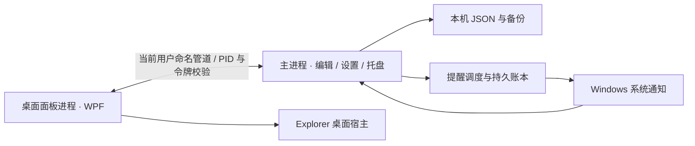

# Re:minder

基于项目设计文档实现的 Windows 11 截止日期面板，首版 **0.1.0**。

**运行：** 双击 `artifacts/ReMinder-win-x64/ReMinder.exe`，保留完整文件夹。发布包内含 .NET 10 与 Windows App SDK 核心运行文件，Windows x64，无需管理员权限。默认空任务、固定到桌面、关闭自启动、提醒静音。

详细操作、可选安装与卸载参见 [使用说明](distribution/使用说明.md)。安装到稳定目录后再启用自启动，以便通知在应用关闭时能够找到同一个 EXE。

## 已实现

- Material You 风格的原生 WPF 面板、空状态、截止摘要、逾期排序、任务卡片、收起与展开。
- 新建与编辑、快捷日期、精确时间、备注、提醒偏移、夏令时校验、未保存修改确认。
- 完成与悬停可暂停的八秒撤销提示、软删除、恢复、历史搜索与筛选。
- 系统/浅色/深色，四套配色，三种面板宽度，显示器与边距设置、Windows 文本缩放与高对比度资源。
- 真实桌面子窗口、可选置顶、桌面连接失败提示与重试、托盘菜单、Explorer 重建与显示/时间/恢复广播。
- 原生 Windows 通知、冷启动激活处理、打开/延后/完成动作、持久化投递账本、失效检查、错过提醒合并与明确失败重试。
- 原子 JSON 保存、最多七份备份、损坏恢复、未来版本只读保护、导出与全量校验后导入、冲突预览。
- 当前用户安装与卸载脚本、可选登录启动；卸载保留任务数据。

## 构建与验证

需要 **.NET SDK 10.0.401** 或兼容补丁（版本由 `global.json` 固定）。本工作区 `.tools/dotnet` 已准备该 SDK，来源和 SHA-512 记录在 `.tools/dotnet-sdk-source.json`；SDK 不纳入 Git。NuGet 来源配置在 `NuGet.config`，依赖锁文件在各项目中。

退出正在运行的开发/发布版本，在 PowerShell 执行：

```powershell
./Build.ps1
```

脚本执行依赖锁定还原、14 组领域与存储检查、Release 自包含发布，并复制使用/安装说明。首次联网还原之后可使用本机缓存。

仅运行领域检查：

```powershell
.tools/dotnet/dotnet.exe run --project tests/ReMinder.Checks -c Release
```

检查包含倒计时边界、DST、排序、创建过去任务、改期作废旧通知、并发版本、撤销、导入原子性、写入失败、备份恢复及未来数据版本保护。测试创建独立目录，不读写正式用户任务。

## 结构



`ReMinder.Domain` 不依赖 UI 或 Windows，负责模型、时间规则、任务服务、存储与 IPC 帧。`ReMinder.App` 使用 WPF 和 Windows App SDK 1.8.260921001。主进程持有数据写入权；渲染进程收到快照并发送操作请求，不能直接保存用户数据。独立进程将 `SetParent` 可能造成的 DPI 上下文变化隔离在面板中。这里采用当前用户命名管道与命名互斥量实现单实例，Windows App SDK 负责通知激活；避免在 WPF STA 上同步阻塞 WinRT 重定向。

## 版本边界

首版已在本机原生窗口与通知中检查，详细证据见 [首次开发验收记录](design/Re-minder-首次开发验收记录.md)。没有在全新 Windows 虚拟机上验证所有安装依赖，也未完成混合 DPI 多显示器、虚拟桌面、Win+D、Explorer 重启和长时间休眠的人工矩阵；相关条目没有标为通过。退出后的准时提醒、唤醒电脑、云同步、多用户并发写同一数据目录不属于此版能力。

应用是未签名的本地开发版本。数据保存在 `%LOCALAPPDATA%/ReMinder`，本地明文，无云端账号。通知“系统已接受”不能推断已读或横幅显示。
